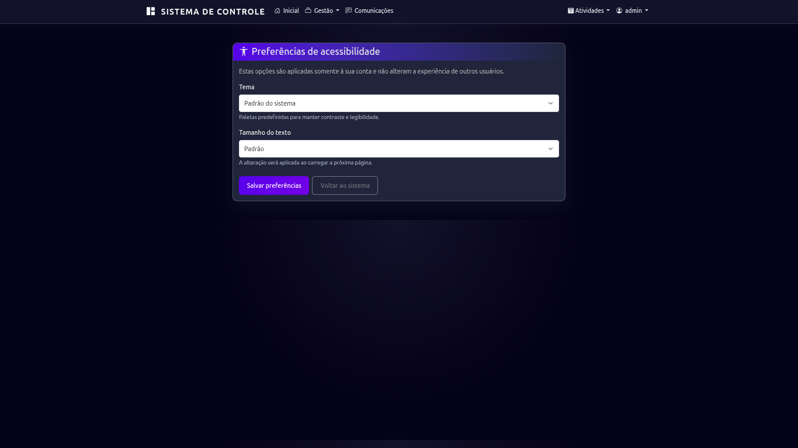

# Guia rápido do Sistema BMCM

Este guia explica as tarefas mais comuns do sistema, sem exigir conhecimento técnico. As opções que aparecem para você dependem do seu tipo de acesso. Se uma opção não estiver disponível ou algo não funcionar, peça ajuda ao administrador do sistema.

## 1. Entrar no sistema

1. Abra no navegador o endereço do sistema fornecido pela Banda.
2. Informe seu usuário e sua senha.
3. Clique em **Entrar**.

No primeiro acesso, siga a orientação para trocar a senha inicial. Depois, para alterá-la, use o cartão **Senha > Alterar** no painel **Inicial**. Se esquecer a senha ou não conseguir entrar, entre em contato com o administrador.

## 2. Encontrar as opções

Use a barra no alto da tela:

* **Inicial**: volta ao painel principal, que mostra indicadores e atalhos para integrantes, escolas, instrumentos e, para administradores, usuários e backups. O cartão **CopyRight** abre os créditos do projeto.
* **Gestão**: reúne integrantes e instrumentos. A opção **Usuários** aparece somente para administradores. A tela de escolas também pode ser aberta pelo atalho **Escolas** em **Inicial**.
* **Atividades**: reúne calendário, ensaios, atividades, eventos e consultas de presença.
* **Comunicações**: abre os avisos e mensagens, quando estiver disponível para sua conta.
* **Seu nome**: abre acessibilidade, saída do sistema e, para administradores, passes, backups, configurações e registros de exclusões.

O Google Calendar aparece quando estiver autorizado. A sincronização de cada ensaio, evento ou atividade é iniciada manualmente na lista correspondente; o calendário do BMCM continua sendo o registro oficial.

Em celular, toque no botão do menu para abrir ou fechar a navegação. Para voltar de uma tela, use o botão **Voltar** quando existir ou o menu superior.

## 3. Ajustar a aparência para você

1. Abra o menu com seu nome.
2. Escolha **Acessibilidade**.
3. Selecione um tema: **Padrão do sistema**, **Tema claro** ou **Tema escuro**.
4. Escolha o tamanho do texto: **Padrão**, **Médio**, **Grande** ou **Muito grande**.
5. Clique em **Salvar preferências**.

Essas escolhas são somente da sua conta. Para aumentar ou diminuir o texto apenas temporariamente, você também pode usar os controles de zoom do navegador.

## 4. Localizar ou cadastrar um integrante

### Procurar um integrante

1. Abra **Gestão > Integrantes**.
2. Digite o nome no campo **Buscar por nome**.
3. Se necessário, escolha **Ativos** ou **Inativos** em **Status**.
4. Clique em **Filtrar**. Para remover a busca, clique em **Limpar**.

Use as ações da linha do integrante para abrir o relatório individual e, conforme sua permissão, editar, ativar/inativar ou excluir o cadastro.

### Cadastrar um integrante

Se a opção estiver disponível para você:

1. Na tela de integrantes, clique em **Novo Integrante**.
2. Preencha as informações solicitadas nas abas.
3. Para o endereço, informe o CEP e use a busca automática quando necessário; confira os dados preenchidos.
4. Revise as informações e clique em **Salvar**.

Ao cadastrar uma pessoa menor de idade, preencha os dados do responsável e as autorizações solicitadas pelo sistema. Se o formulário indicar que falta uma informação, complete-a antes de salvar.

## 5. Consultar calendário e registrar presença

### Ver o calendário

1. Abra **Atividades > Calendário BMCM**.
2. Use **Hoje**, as setas ou o seletor de mês para encontrar a data.
3. Selecione um dia para consultar os ensaios, eventos e atividades registrados.
4. Use **Agenda** para ver uma lista em ordem de data ou **Mês** para voltar ao calendário mensal.
5. Se necessário, filtre por tipo ou status e pesquise por título, local ou status.

Para cadastrar, use **Novo ensaio** ou **Novo evento** no calendário, ou abra **Atividades > Ensaios/Eventos** e escolha a opção correspondente. Preencha os campos obrigatórios e salve; depois, abra **Chamada** para registrar as presenças.

Nas listas **Ensaios** e **Eventos**, use **Editar** para corrigir os dados ou **Cancelar** quando a atividade não ocorrer. O cancelamento mantém o registro e o histórico de presença. Nas listas, **Sincronizar** envia o item ao Google Calendar ou atualiza a cópia já vinculada.

### Fazer a chamada

1. No calendário ou na lista de ensaios/eventos, abra a **Chamada** correspondente.
2. Para cada integrante, marque **Presente**, **Ausente** ou **Justificado**.
3. Confira os nomes e a atividade selecionada.
4. Clique em **Salvar presença**.

Para integrantes com cartão ativo, cada presença consome dois passes. Se o saldo for menor que dois, o sistema bloqueia o registro; peça ao administrador para verificar o saldo. Integrantes sem cartão podem ter a presença registrada normalmente, sem consumo de passes.

## 6. Registrar uma atividade avulsa

Para registrar um treinamento ou outra atividade que não esteja na lista de ensaios:

1. Abra **Atividades > Atividades avulsas** ou **Calendário BMCM**.
2. Clique em **Nova atividade**.
3. Informe tipo, título e data. Horários, área, responsável, local e observações podem ser preenchidos quando aplicáveis.
4. Clique em **Criar atividade**.
5. Para registrar a chamada, abra **Chamada** na lista de atividades.

## 7. Consultar frequência e relatórios

* Para ver as chamadas registradas, abra **Atividades > Relatório de presença**. Escolha um integrante ou mantenha todos e clique em **Filtrar histórico**.
* Para consultar os totais de um mês, abra **Atividades > Resumo mensal**, escolha o mês e clique em **Consultar**. Nessa tela, use **Relatório profissional** para abrir o documento do período.
* No calendário, use **Relatório diário** para imprimir a folha de uma data; na lista de eventos, use **Relatório** para consultar a chamada do evento.
* Para relatórios de integrantes, use **Relatórios** na tela **Integrantes** e o ícone de relatório da linha. Para o relatório de escolas, abra **Escolas > Relatório**.
* Para imprimir ou salvar em PDF, use **Imprimir** e escolha **Salvar como PDF** na janela de impressão do navegador.

## 8. Gerir escolas, instrumentos e usuários

### Escolas

Em **Inicial > Escolas**, consulte a lista, cadastre ou edite uma escola, use as ações disponíveis para removê-la e abra o relatório de escolas e integrantes vinculados.

### Instrumentos, tipos e naipes

Abra **Gestão > Instrumentos** para pesquisar e consultar o patrimônio. Administradores podem cadastrar, editar, ativar/inativar e excluir instrumentos. Use **Gerenciar Tipos** e **Gerenciar Naipes** nessa tela para manter as categorias de instrumento e seções da Banda, conforme as permissões da sua conta.

### Usuários (administradores)

Abra **Gestão > Usuários** ou o atalho **Usuários** em **Inicial** para criar e editar contas, definir o perfil de administrador, ativar ou bloquear acessos, redefinir senhas e excluir contas. Após uma redefinição, a pessoa deverá trocar a senha no próximo acesso. Um usuário não pode excluir nem bloquear a própria conta; a conta protegida do sistema não pode ser alterada por outro administrador.

## 9. Enviar ou consultar uma comunicação

Quando **Comunicações** estiver disponível:

1. Abra o menu **Comunicações**.
2. Para preparar um aviso, clique em **Nova comunicação**.
3. Informe o assunto e a mensagem, escolha o público e, se necessário, anexe arquivos.
4. Confira o conteúdo e os destinatários antes de enviar. Para contatos externos, confirme a autorização de e-mail solicitada pelo sistema.
5. Clique em **Enviar** e confirme quando o sistema pedir.

O sistema mostra o resultado do envio no histórico e informa se ficou como **Rascunho**, **Enviado**, **Parcial** ou **Falhou**. Se a mensagem falhar ou for enviada apenas para parte do público, confira o status e peça ajuda ao administrador. Não envie dados pessoais desnecessários. A autorização de e-mail de um contato externo pode ser revogada na Central.

## 10. Passes de transporte (administradores)

1. Abra o menu com seu nome e escolha **Passes de Transporte**.
2. Selecione o mês de referência.
3. Escolha o integrante com cartão ativo.
4. Para disponibilizar os passes do mês, use **Cota mensal**. Para um lançamento **Avulso**, permitido uma vez por mês para cada integrante, informe a quantidade e explique o motivo.
5. Clique em **Confirmar lançamento**. Consulte **Histórico** para conferir os movimentos e o saldo.

Cada presença consome dois passes para integrantes com cartão. A recarga extra exige motivo; confirme o mês, o integrante e a quantidade antes de lançar.

## 11. Backups (administradores)

Em **Seu nome > Backup do Banco**, clique em **Criar Backup Agora** e confira a mensagem de resultado. A cópia local é mantida mesmo se o envio ao Google Drive falhar; use o botão **Drive** para tentar enviá-la novamente. Os backups novos são protegidos por senha; preserve essa senha fora do computador servidor.

Para restaurar uma cópia, selecione **Restaurar** na cópia local ou na cópia do Drive e leia com atenção a confirmação. A restauração substitui os dados atuais; o sistema cria uma cópia de segurança antes da troca. Depois da restauração, o administrador deverá reiniciar o sistema. Também é possível excluir cópias locais pela lista de backups.

## 12. Configurações e manutenção (administradores)

Em **Seu nome > Configurações**, o administrador pode personalizar a tela de entrada e o rodapé, definir regras de senha e tempo de sessão, ajustar limites de envio de arquivos e opções de backup e retenção de registros, além de autorizar os serviços Google usados para Gmail, Calendar e Drive.

Na aba **Sistema/Manutenção**, estão disponíveis a limpeza de cache, a verificação de integridade e a reindexação do banco de dados. O item **Logs: Hard Delete** permite consultar o histórico de exclusões permanentes de integrantes. Use essas opções administrativas com cuidado; se não souber qual ação escolher, peça orientação antes de prosseguir.

## 13. Sair do sistema

Abra o menu com seu nome e clique em **Sair**, principalmente quando estiver usando um computador compartilhado.

## Precisa de ajuda?

Anote o que estava tentando fazer e a mensagem exibida. Entre em contato com o administrador do BMCM. Não compartilhe sua senha nem envie capturas de tela que mostrem dados pessoais.
