# Manual do Usuário - Sistema BMCM

## Sistema de Gestão da Banda Marcial Municipal de Marília - SP

---
> 📘 Este manual foi desenvolvido para orientar o uso do Sistema BMCM.
>
> Para dúvidas técnicas, entre em contato com o administrador.

## 1. Introdução

### 1.1 Objetivo do Sistema
O Sistema BMCM é uma aplicação web desenvolvida para apoiar a gestão administrativa da Banda Marcial Municipal de Marília - SP. O sistema permite o cadastro, consulta, atualização e acompanhamento de integrantes da banda, com foco em organização administrativa e continuidade histórica dos dados.

### 1.2 Público-Alvo
- Administradores do sistema
- Profissionais responsáveis pela gestão
- Coordenadores da banda

### 1.3 Requisitos de Acesso
- Navegador web moderno (Chrome, Firefox, Edge, Safari)
- Conexão com o servidor onde o sistema está hospedado
- Credenciais de acesso (usuário e senha)
- Arquivo local `.env` configurado com as variáveis de ambiente do sistema e do Google OAuth, quando a integração do Google estiver habilitada

---

## 2. Guia Rápido

Siga os passos abaixo para começar a utilizar o sistema rapidamente:

1. Acesse o sistema pelo navegador
2. Informe seu usuário e senha
3. Após o login, acesse **Gestão > Integrantes** (ou o atalho **Integrantes** do painel **Inicial**)
4. Se a opção estiver disponível para sua conta, clique em **Novo Integrante**
5. Preencha os dados obrigatórios
6. Clique em **"Salvar"**

✔ Pronto! O integrante já estará cadastrado no sistema.

> Dica: as opções disponíveis dependem da conta. O menu **Gestão** contém Integrantes, Instrumentos e, para administradores, Usuários. O menu **Atividades** contém Calendário BMCM, Ensaios, Atividades avulsas, Relatório de presença, Resumo mensal e Eventos. O atalho **Escolas** fica no painel **Inicial**.
>
## 3. Acesso ao Sistema

### 3.1 Tela de Login
Ao acessar o sistema, o usuário será direcionado para a tela de login.

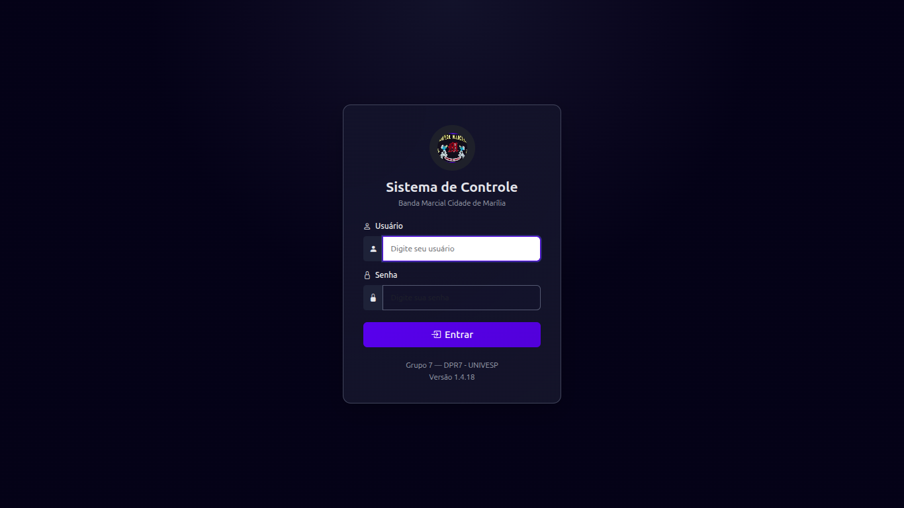

**Campos:**
- **Usuário**: Campo obrigatório para inserção do nome de usuário
- **Senha**: Campo obrigatório para inserção da senha

**Botão "Entrar"**: Realiza a autenticação no sistema

### 3.2 Primeiro Acesso
Quando a conta exigir a troca da senha no primeiro acesso (por exemplo, após uma redefinição pelo administrador), o sistema direcionará o usuário para a tela de alteração. O usuário deverá:
1. Inserir a senha atual (fornecida pelo administrador)
2. Criar uma nova senha com no mínimo 6 caracteres e atender aos requisitos de complexidade configurados pelo administrador
3. Confirmar a nova senha

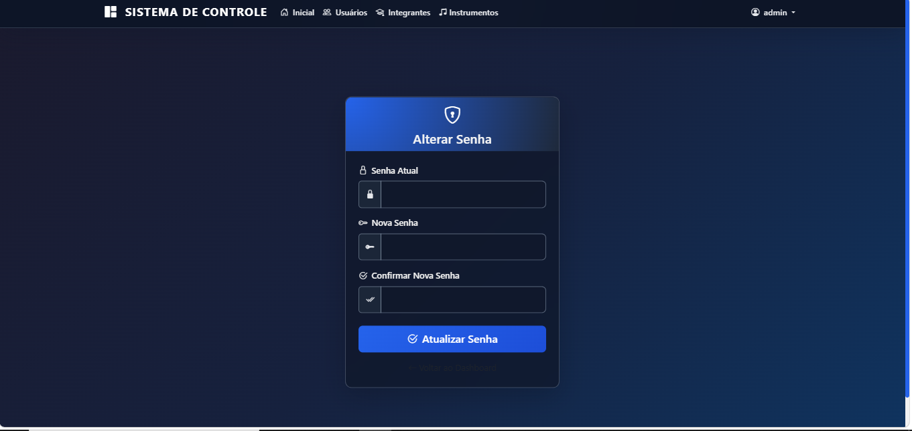

Para alterar a senha posteriormente, use o cartão **Senha > Alterar** no painel **Inicial**. A senha atual é solicitada.

### 3.3 Configuração do arquivo `.env`
Antes de utilizar integrações com o Google, o administrador deve configurar o arquivo `.env` do projeto com as credenciais do Google OAuth 2.0 e a chave secreta da aplicação.

Variáveis principais:
- `GOOGLE_OAUTH_CLIENT_ID`
- `GOOGLE_OAUTH_CLIENT_SECRET`
- `GOOGLE_OAUTH_REDIRECT_URI`
- `GOOGLE_OAUTH_SCOPES`
- `SECRET_KEY`
- `BACKUP_PASSWORD` (opcional; senha de backup com pelo menos 16 caracteres)

O arquivo `.env` deve permanecer fora do Git e não deve ser enviado para repositórios públicos.

A senha do backup também pode ser registrada na guia **Configurações > Sistema/Manutenção**, após informar a senha atual do administrador. A senha salva no `.env` pode ser revelada somente após nova reautenticação administrativa. Se já existir uma chave local ou backups protegidos, a interface só aceita registrar a mesma chave para preservar a restauração.

### 3.4 OAuth do Google e Google Workspace
Em **Seu nome > Configurações**, o administrador pode iniciar a autorização dos serviços Gmail, Google Calendar e Google Drive usados pelo sistema. Cada serviço depende de seu escopo autorizado. O escopo Drive é `drive.file` e limita o acesso aos arquivos e pastas criados pela aplicação.

Após a autorização, o sistema salva o token localmente em `instance/google_oauth_token.json`. O token é usado para enviar mensagens pelo Gmail, sincronizar ensaios, eventos e atividades avulsas para o Google Calendar e enviar backups ao Google Drive, conforme os escopos autorizados.

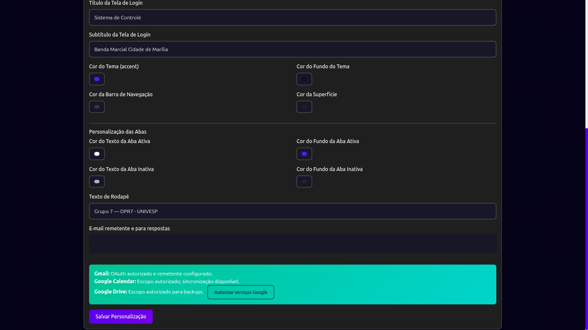

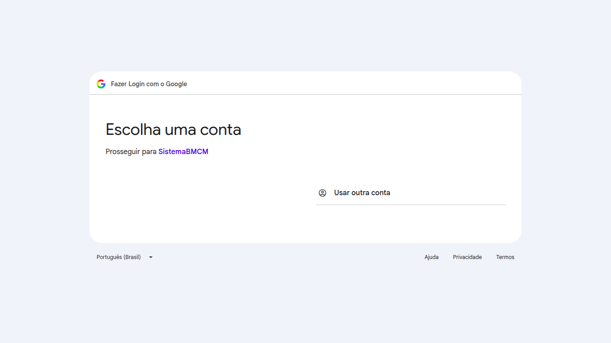

### 3.5 Recuperação de Senha
Em caso de esquecimento de senha, entre em contato com o administrador do sistema.

### 3.6 Preferências de acessibilidade
Abra o menu com seu nome e escolha **Acessibilidade**. Selecione o tema (**Padrão do sistema**, **Tema claro** ou **Tema escuro**) e o tamanho do texto (**Padrão**, **Médio**, **Grande** ou **Muito grande**), depois clique em **Salvar preferências**. As escolhas são individuais e não alteram a aparência das outras contas.

---

## 4. Dashboard (Painel Principal)

### 4.1 Visão Geral
Após o login, o usuário acessa o dashboard que apresenta estatísticas gerais do sistema:

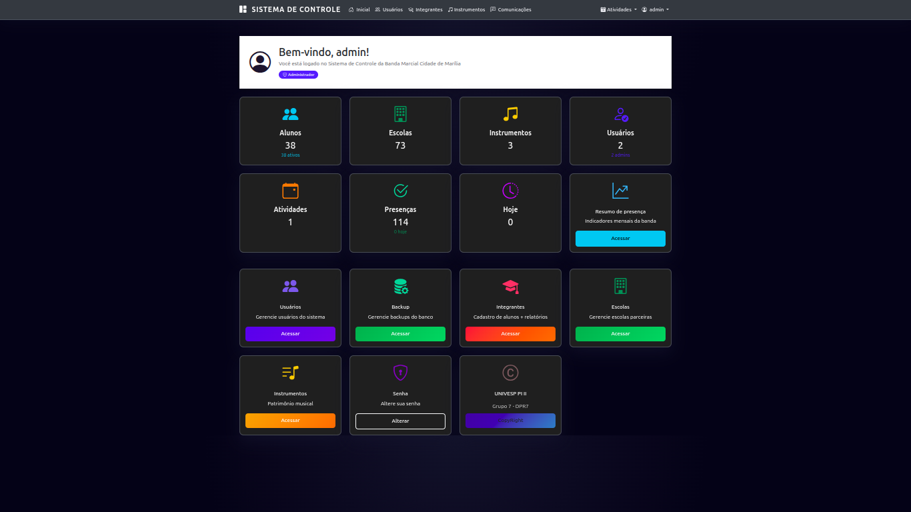

O painel apresenta indicadores de integrantes cadastrados e ativos, escolas, instrumentos ativos, usuários, atividades e presenças, além de atalhos para módulos principais. Os atalhos de **Usuários** e **Backup** aparecem para administradores. O cartão **Senha** permite alterar a senha; **CopyRight** abre os créditos do projeto.

### 4.2 Menu de Navegação
O menu principal fica na barra superior. **Gestão** reúne Integrantes e Instrumentos e, para administradores, Usuários. **Atividades** reúne Calendário BMCM, Ensaios, Atividades avulsas, Relatório de presença, Resumo mensal e Eventos. **Escolas** é acessada pelo atalho no painel **Inicial**. O acesso a **Comunicações** e **Google Calendar** depende da autorização/configuração correspondente. O menu com seu nome contém Acessibilidade e Sair; administradores também encontram Usuários, Backup do Banco, Logs: Hard Delete, Configurações e Passes de Transporte.

---

## 5. Gestão de Usuários (Administrador)

### 5.1 Listar Usuários
Acesse **Gestão > Usuários** ou **Seu nome > Gerenciar Usuários** para visualizar as contas cadastradas.

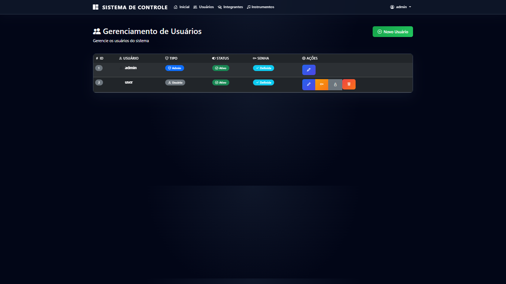

**Informações exibidas:**
- Nome de usuário
- Tipo (administrador ou conta sem perfil de administrador)
- Status (ativo ou bloqueado)
- Situação da senha (definida ou troca pendente)

### 5.2 Criar Novo Usuário
1. Acesse **Gestão > Usuários**
2. Clique em **"Novo Usuário"**
3. Preencha os campos:

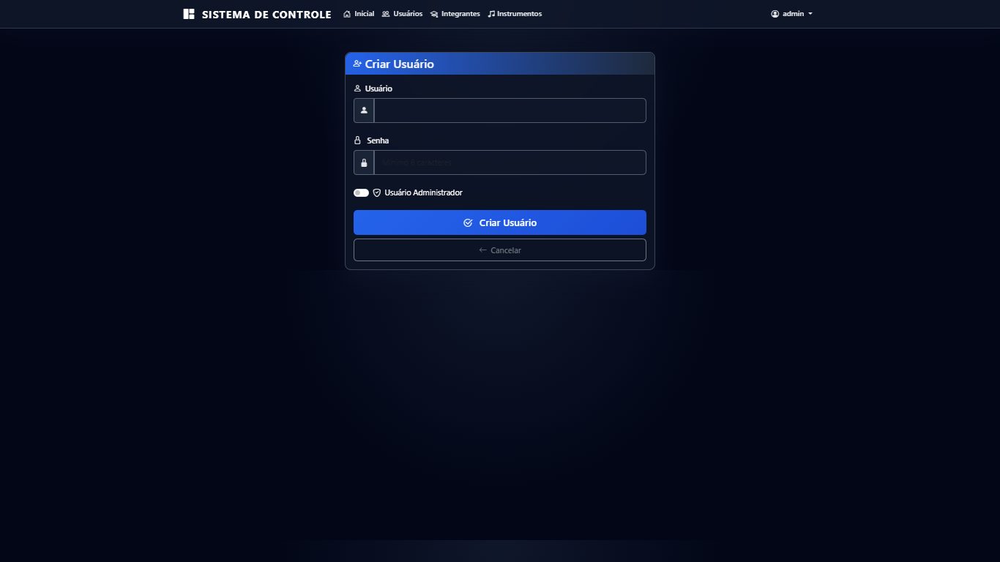

- **Usuário**: Nome de login (único)
- **Senha**: Senha inicial
- **Administrador**: Marque se o usuário terá acesso administrativo
4. Clique em **"Salvar"**

A senha precisa ter pelo menos 6 caracteres e atender aos requisitos de complexidade definidos em **Configurações > Segurança**. A nova conta deverá trocar a senha no primeiro acesso.

### 5.3 Editar Usuário
1. Acesse **Gestão > Usuários**
2. Clique no botão de edição ao lado do usuário desejado
3. Altere os dados necessários
4. Clique em **"Salvar"**

**Nota**: O nome de usuário não pode ser alterado após a criação.

### 5.4 Redefinir Senha de Usuário
1. Acesse **Gestão > Usuários**
2. Clique em **"Resetar Senha"** ao lado do usuário
3. A senha será redefinida para a senha inicial padrão do sistema e a pessoa precisará alterá-la no próximo acesso. Entregue a senha temporária por um meio seguro.

### 5.5 Ativar/Desativar Usuário
1. Acesse **Gestão > Usuários**
2. Clique no botão de alternância ao lado do usuário
3. O usuário será ativado ou bloqueado imediatamente

### 5.6 Excluir Usuário
1. Acesse **Gestão > Usuários**
2. Clique no botão de exclusão ao lado do usuário
3. Confirme a exclusão na mensagem apresentada

**Nota**: a conta `admin` é protegida contra alterações feitas por outra conta. Um administrador também não pode bloquear ou excluir a própria conta.

---

## 6. Gestão de Alunos/Integrantes

### 6.1 Listar Alunos
Acesse **Gestão > Integrantes** para consultar os cadastros.

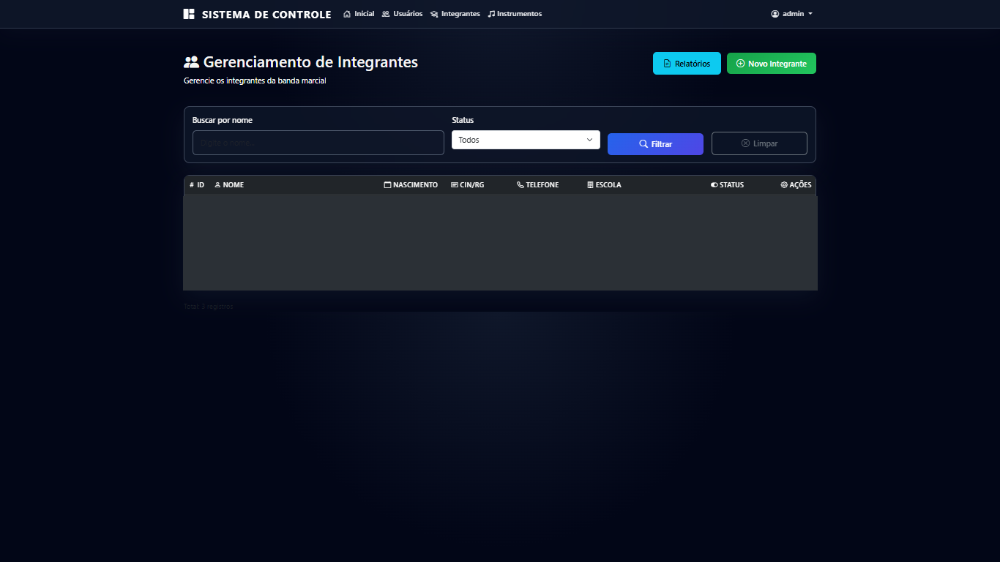

**Filtros disponíveis:**
- Busca por nome
- Filtrar por status (ativos/inativos)

**Informações exibidas:**
- Nome do integrante
- Data de nascimento
- Escola
- Instrumento atual
- Status (ativo/inativo)
- Ações disponíveis para a conta (relatório, edição, ativação/inativação ou exclusão)

### 6.2 Cadastrar Novo Integrante
1. Acesse **Gestão > Integrantes**
2. Clique em **"Novo Integrante"**, quando disponível
3. Preencha os dados em abas:

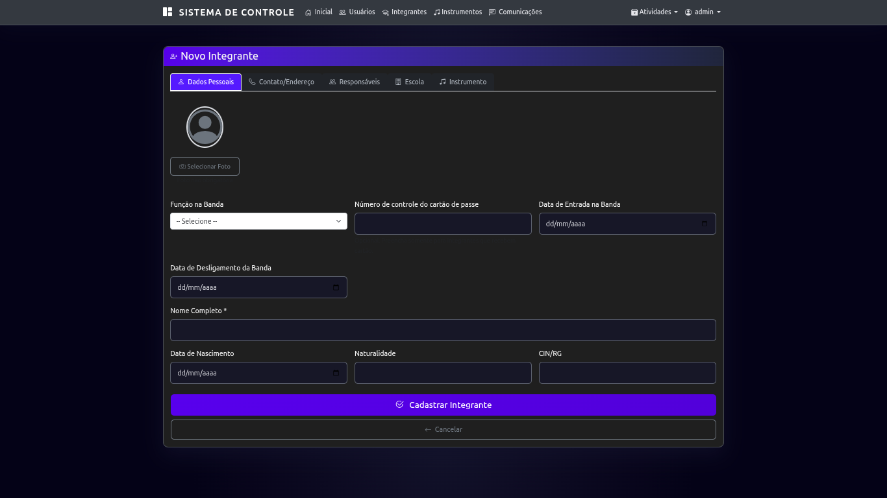

**Aba Dados Pessoais:**
- Nome completo (obrigatório)
- Data de nascimento
- Naturalidade
- CPF/RG
- E-mail
- Telefone

**Aba Endereço:**
- CEP (busca automática)
- Endereço
- Número
- Complemento
- Bairro
- Cidade
- Estado

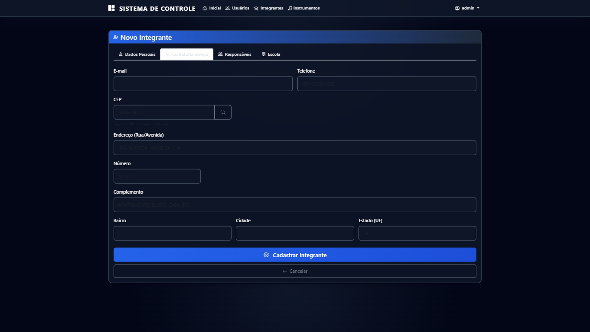

**Aba Informações da Banda:**
- Função na banda, datas de entrada/desligamento e foto do integrante
- Número de controle do cartão de passe, se houver

**Aba Escola:**
- Selecione a escola

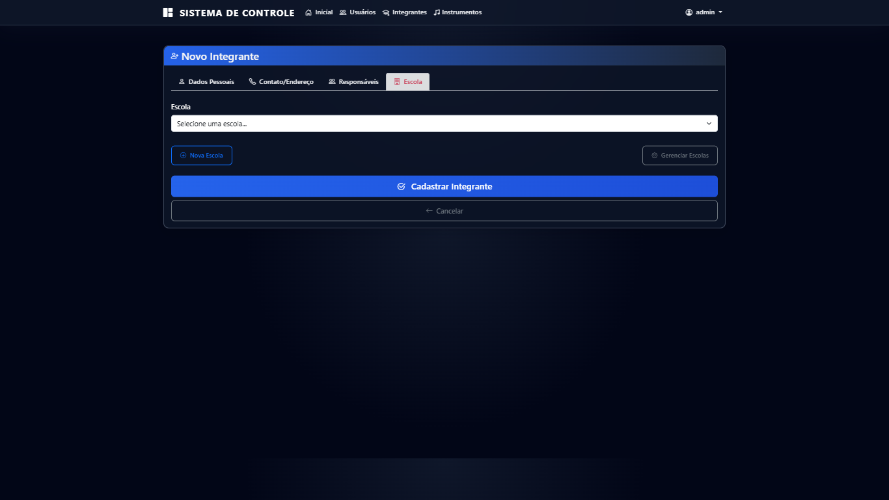

**Aba Instrumento:**
- Selecione o instrumento atualmente associado ao integrante
- Informe observações, quando necessário

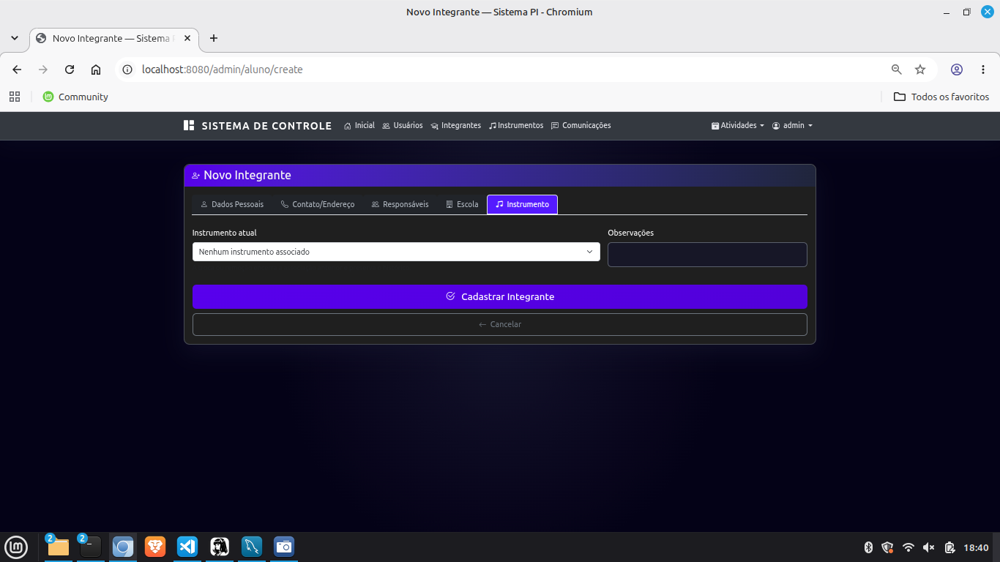

Ao trocar o instrumento, a associação anterior recebe uma data de devolução e permanece no histórico. Instrumentos inativos não podem ser associados a novos integrantes.

**Responsáveis:**
- Nome do pai e/ou da mãe, telefone, e-mail e endereço do responsável, quando aplicável

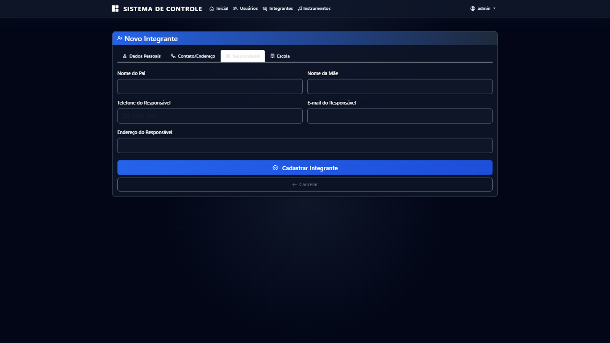

4. Clique em **"Salvar"**

### 6.3 Cadastro de integrante menor de idade

Para integrante menor de 18 anos, o termo de autorização de imagem e a assinatura do responsável são obrigatórios quando uma foto é enviada ou substituída:

1. Selecione a foto na aba **Dados Pessoais**.
2. Preencha os dados do responsável que autoriza, confirme o termo e registre a assinatura digital.
3. Salve o cadastro. O sistema vincula a autorização à foto registrada.

Sem foto nova, o cadastro não exige essa autorização de imagem. Ao trocar a foto de um menor, é necessário coletar novo consentimento e assinatura.

### 6.4 Editar Integrante
1. Acesse **Gestão > Integrantes**
2. Clique no botão de edição ao lado do integrante desejado, se disponível
3. Altere os dados necessários
4. Clique em **"Salvar"**

### 6.5 Consultar o relatório individual
1. Acesse **Gestão > Integrantes**
2. Clique no ícone **Relatório** ao lado do integrante
3. O sistema abre o relatório individual, preparado para consulta e impressão.

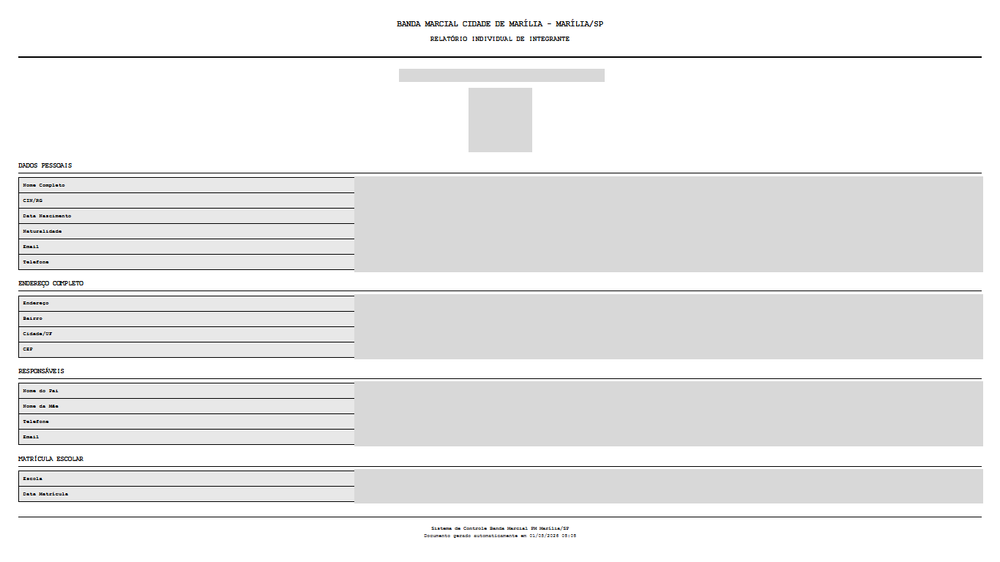

### 6.6 Ativar, inativar ou excluir cadastro
1. Acesse **Gestão > Integrantes**
2. Use os controles da linha do integrante, disponíveis para administradores.
3. Para excluir totalmente um cadastro, informe a justificativa solicitada pelo sistema.

Inativar preserva o cadastro e o histórico. A exclusão total é permanente; seus registros de auditoria podem ser consultados em **Seu nome > Logs: Hard Delete**. Prefira inativar quando não houver necessidade de remoção definitiva.

---

## 7. Gestão de Escolas

### 7.1 Listar Escolas
No painel **Inicial**, clique em **Escolas** para visualizar as escolas cadastradas.

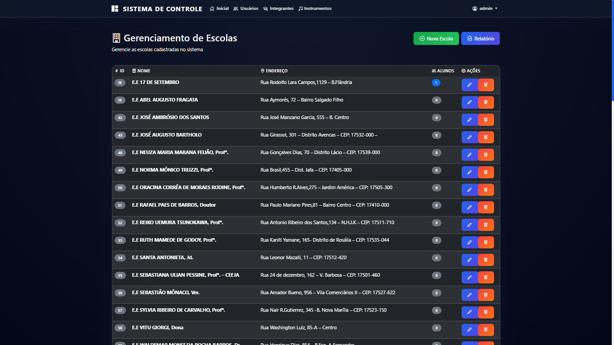

**Informações exibidas:**
- Nome da escola
- Endereço
- Quantidade de alunos vinculados
- Ações (editar, excluir)

### 7.2 Cadastrar Nova Escola
1. No painel **Inicial**, clique em **Escolas**
2. Clique em **"Nova Escola"**
3. Preencha os campos:

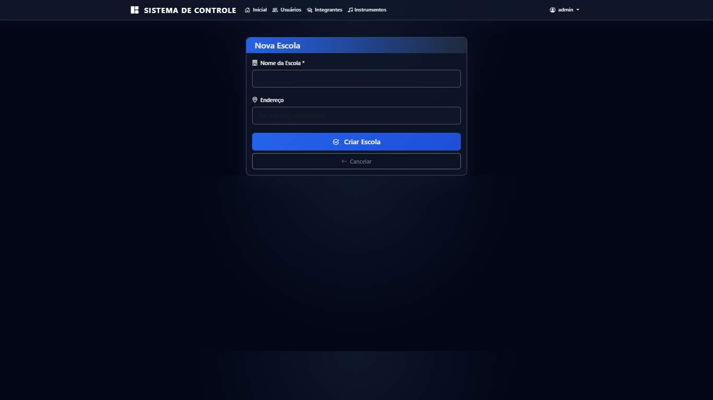

- **Nome**: Nome da escola (obrigatório)
- **Endereço**: Endereço completo
4. Clique em **"Salvar"**

### 7.3 Editar Escola
1. No painel **Inicial**, clique em **Escolas**
2. Clique no botão de edição ao lado da escola desejada
3. Altere os dados necessários
4. Clique em **"Salvar"**

### 7.4 Excluir Escola
1. No painel **Inicial**, clique em **Escolas**
2. Clique no botão de exclusão ao lado da escola
3. Confirme a exclusão

Confira os vínculos antes de confirmar. Se a escola tiver integrantes vinculados e a remoção não for permitida, atualize os vínculos primeiro ou peça ajuda ao administrador.

### 7.5 Relatório de Escolas
Na tela de Escolas, clique em **Relatório** para abrir a versão imprimível das escolas e seus integrantes vinculados.

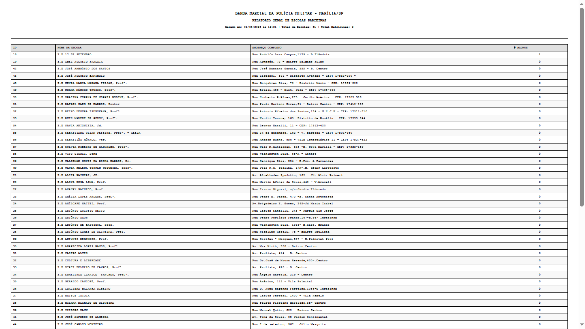

---

## 8. Gestão de Instrumentos

### 8.1 Listar Instrumentos
Acesse **Gestão > Instrumentos** para consultar o patrimônio. É possível pesquisar por nome e filtrar por status ou tipo.

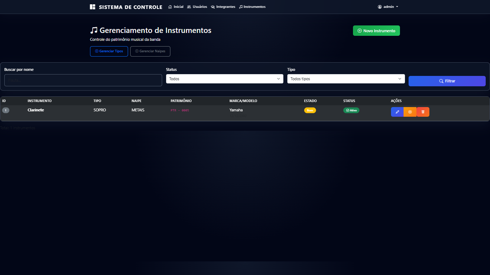

**Informações exibidas:**
- Nome do instrumento
- Tipo
- Naipe
- Status (ativo/inativo)
- Ações (editar, ativar/inativar)

### 8.2 Cadastrar Novo Instrumento
1. Acesse **Gestão > Instrumentos**
2. Clique em **"Novo Instrumento"**
3. Preencha os campos:

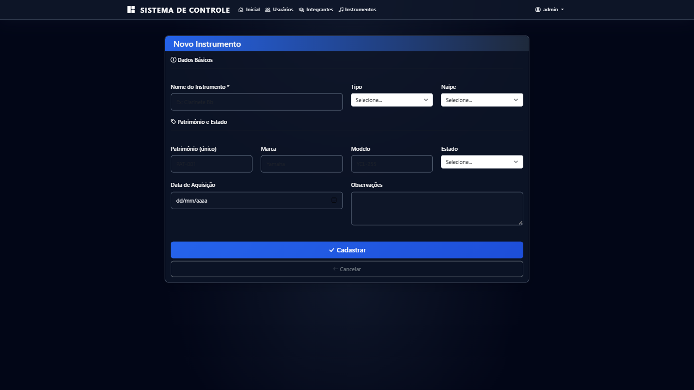

- **Nome**: Nome do instrumento (obrigatório)
- **Tipo**: Categoria do instrumento
- **Naipe**: Seção da banda
- **Patrimônio**: Identificador patrimonial único, quando aplicável
- **Marca, modelo, estado e data de aquisição**
- **Observações**
4. Clique em **"Salvar"**

### 8.3 Editar, ativar/inativar ou excluir
1. Acesse **Gestão > Instrumentos**
2. Clique no botão de edição ao lado do instrumento desejado
3. Altere os dados e salve; use os controles da linha para ativar/inativar ou excluir, conforme disponíveis na tela.

### 8.4 Tipos e Naipes
Na tela **Instrumentos**, use **Gerenciar Tipos** e **Gerenciar Naipes** para manter as categorias de instrumentos e as seções da Banda. As telas oferecem ações para incluir, editar e remover registros.

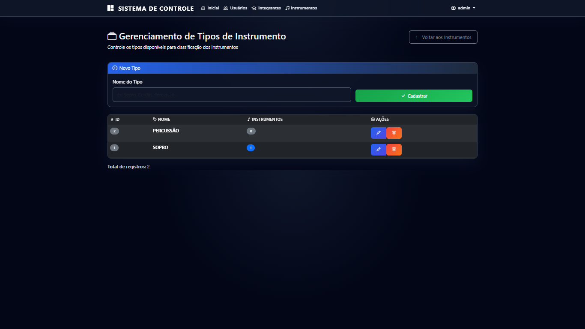

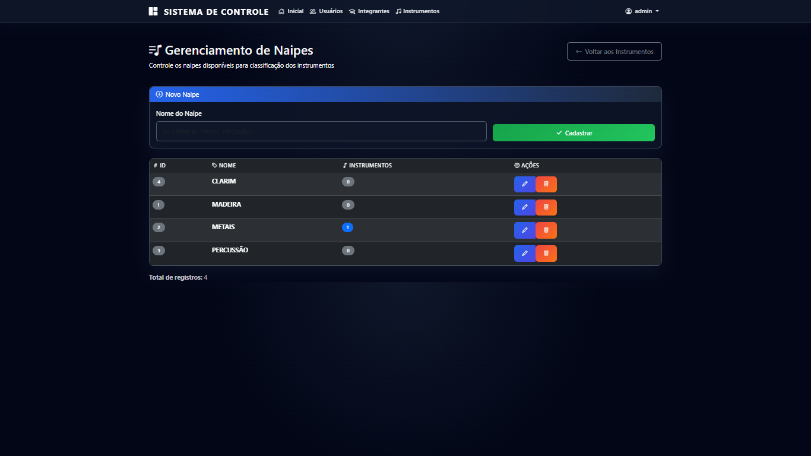

---

## 9. Presença, Ensaios e Eventos

### Calendário BMCM

No menu **Atividades**, acesse **Calendário BMCM** para visualizar os ensaios, eventos e atividades avulsas cadastrados por mês. Use as setas, o seletor de mês ou **Hoje** para navegar; selecione um dia para consultar seus registros.

Use os filtros para pesquisar por título, local ou status e restringir a consulta por tipo de registro. A visualização **Mês** exibe a grade tradicional; a visualização **Agenda** lista os registros em ordem cronológica. Os indicadores mostram o total de registros, quantos possuem chamada, quantos estão pendentes e o total de presenças.

Para cada registro, use **Chamada** para lançar ou consultar presença e, quando disponível, **Relatório**. **Relatório diário** abre a folha consolidada da data. Os botões de criação do dia abrem o formulário correspondente com a data selecionada já preenchida.

O calendário BMCM é independente do Google Calendar. A grade não representa horário de funcionamento da Banda e não presume horário para atividades sem essa informação. A sincronização Google é manual e opcional em cada registro.

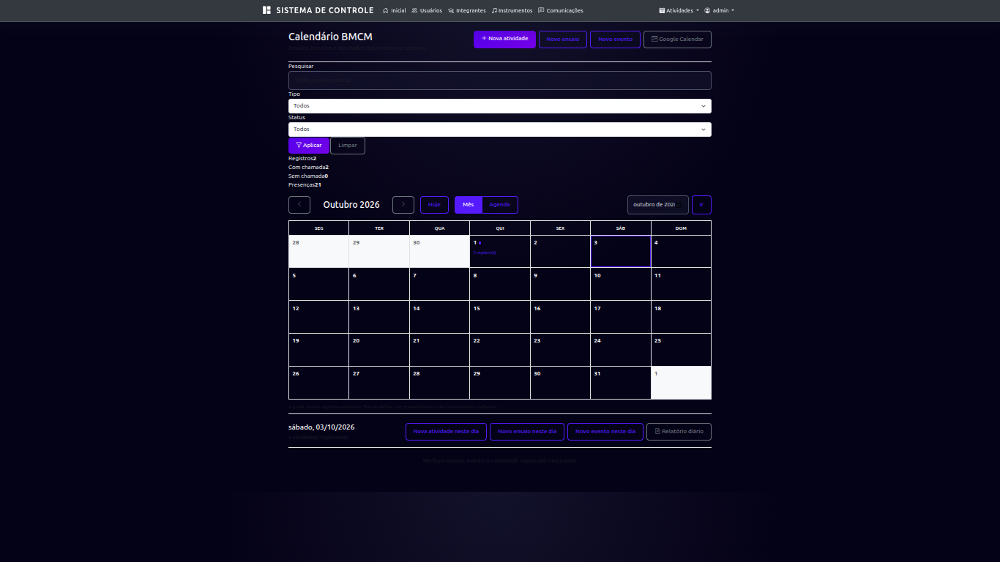

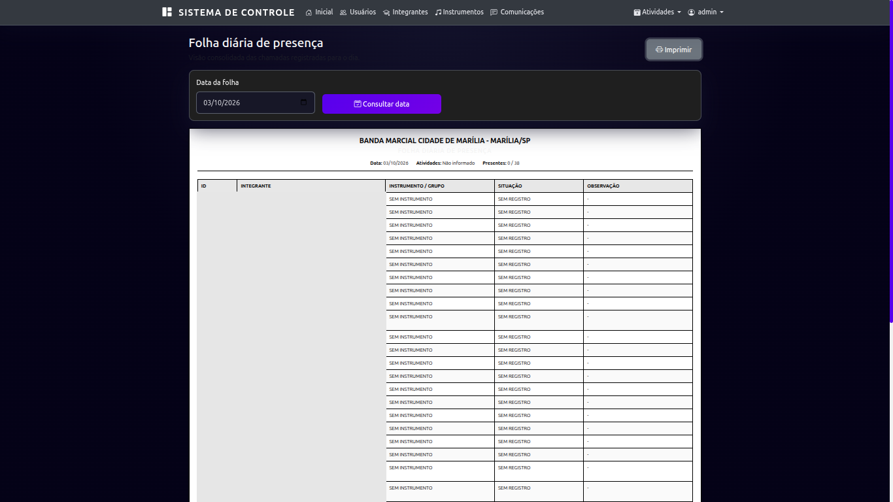

### 9.1 Criar um Ensaio

1. No menu superior, abra **Atividades** e clique em **Ensaios**
2. Clique em **Novo ensaio**
3. Informe:
  - título;
  - data;
  - horário;
  - local;
  - observações;
  - status.
4. Clique em **Criar e registrar chamada**

Após o cadastro, o sistema abrirá automaticamente a folha de chamada.

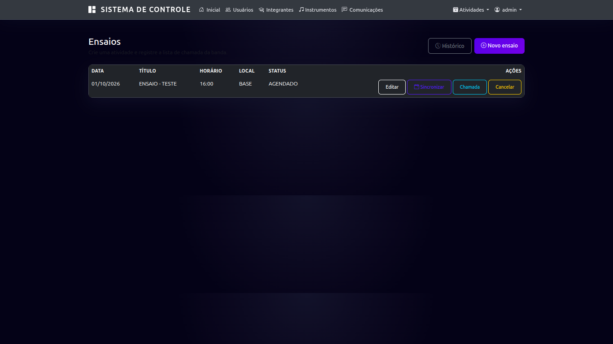

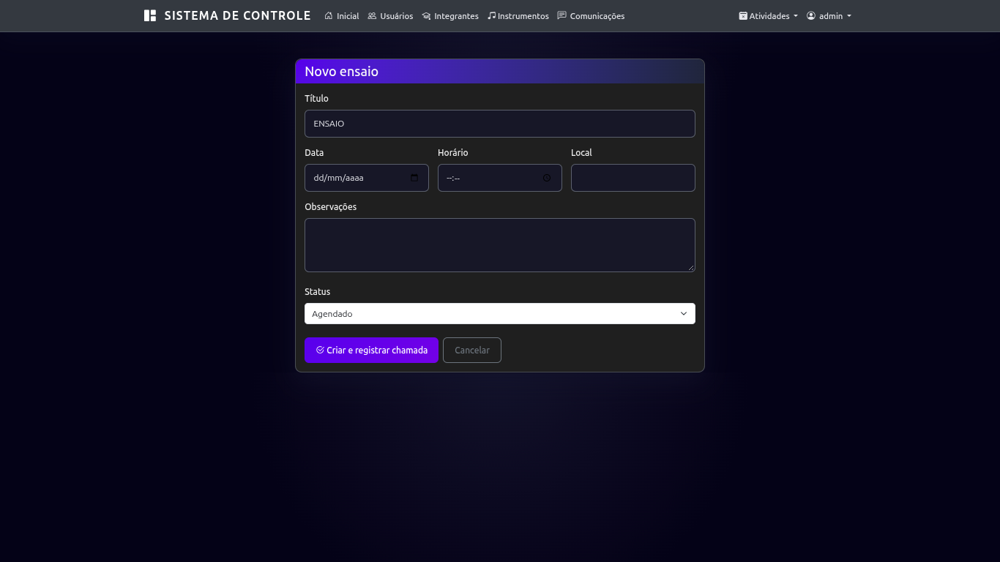

### 9.2 Registrar Presença

Na folha de chamada, os integrantes ativos são agrupados pelo instrumento atualmente associado. Para cada integrante, marque uma situação:

- **Presente**;
- **Ausente**;
- **Justificado**.

Clique em **Salvar presença** para registrar ou atualizar a chamada. O usuário responsável e o horário do registro são armazenados para auditoria.

O botão **Imprimir** gera uma versão adequada para impressão e conferência durante o ensaio.

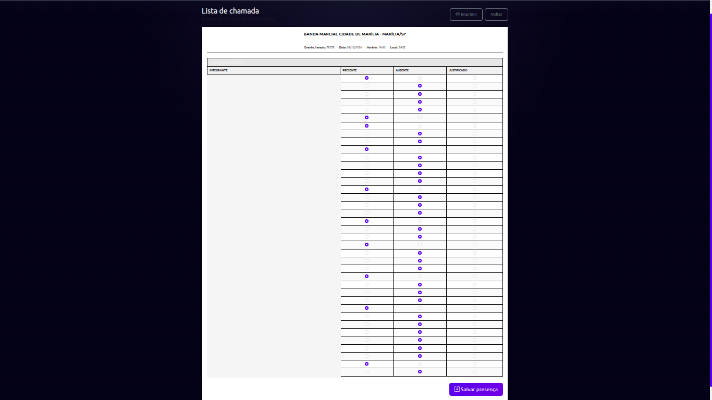

### 9.3 Editar ou Cancelar um Ensaio

Na tela **Ensaios**, use:

- **Editar** para alterar título, data, horário, local, observações ou status;
- **Cancelar** para alterar o status para cancelado.

O cancelamento não exclui o ensaio nem suas presenças, preservando o histórico administrativo.

Na listagem de ensaios, use **Sincronizar** para publicar o ensaio no Google Calendar. Após a primeira sincronização, edições e cancelamentos feitos no BMCM tentam atualizar o evento vinculado. Se a API estiver indisponível ou a autorização tiver expirado, o ensaio permanece salvo no BMCM e uma mensagem informa a falha. Ensaios com horário são enviados com duração padrão de uma hora; sem horário, são enviados como eventos de dia inteiro. A sincronização depende da autorização do escopo Calendar.

### 9.4 Criar um Evento ou Apresentação

1. No menu **Atividades**, clique em **Eventos** (ou use **Novo evento** no Calendário BMCM)
2. Clique em **Novo evento**
3. Informe:
  - nome do evento;
  - data;
  - cidade ou local;
  - status;
  - responsável;
  - telefone.
4. Clique em **Criar e registrar chamada**

Os status disponíveis são **A confirmar**, **Confirmado** e **Cancelado**.

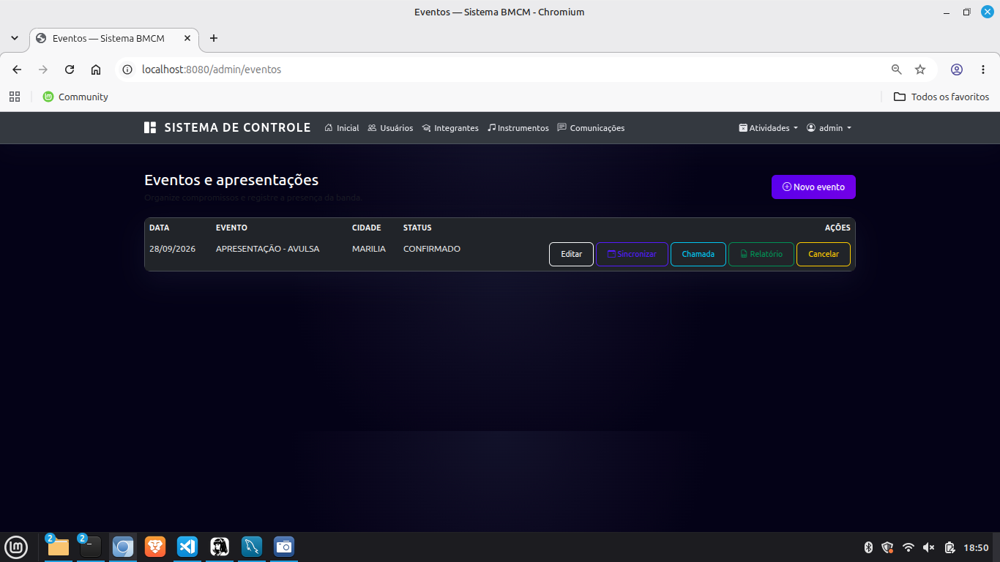

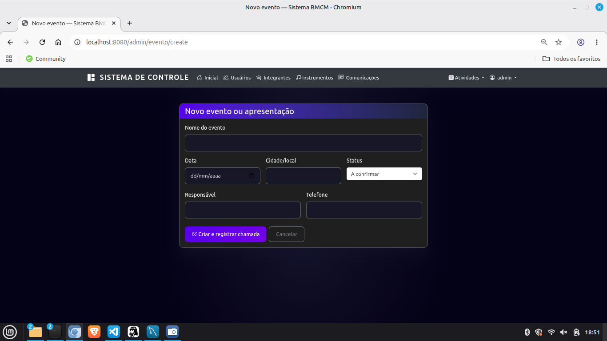

### 9.5 Registrar Presença em Evento

Na listagem de **Eventos**, clique em **Chamada**. A folha funciona da mesma forma que a folha de ensaio, agrupando integrantes por instrumento e permitindo marcar presença, ausência ou justificativa.

### 9.6 Editar ou Cancelar um Evento

Na tela **Eventos**, use **Editar** para atualizar os dados do evento. Use **Cancelar** quando a apresentação não for realizada.

O cancelamento é lógico: os dados do evento e os registros de presença permanecem disponíveis para consulta.

Na listagem de eventos, use **Sincronizar** para publicar o evento no Google Calendar como evento de dia inteiro. Depois da primeira sincronização, edições e cancelamentos feitos no BMCM tentam atualizar o evento vinculado. Se a API estiver indisponível ou a autorização tiver expirado, o evento permanece salvo no BMCM e uma mensagem informa a falha. Alterações feitas diretamente no Google Calendar não são importadas para o BMCM.

### 9.7 Criar e publicar uma atividade avulsa

1. No menu **Atividades**, abra **Atividades avulsas** ou o **Calendário BMCM**.
2. Clique em **Nova atividade**.
3. Informe o tipo (treinamento, apresentação ou outra), título e data. Horários, local, área, responsável e observações podem ser preenchidos quando aplicáveis.
4. Clique em **Criar atividade**; o sistema abrirá a chamada para registrar presença.

Na lista de atividades, use **Chamada** para consultar ou registrar presenças. A sincronização com o Google Calendar é manual:

1. Acesse **Atividades** e crie o treinamento, apresentação ou outra atividade.
2. Na listagem, clique em **Sincronizar Calendar**. A sincronização é manual e exige que o escopo Google Calendar esteja autorizado.
3. Se a atividade já tiver sido sincronizada, use **Atualizar calendário** para atualizar o mesmo evento remoto.

Quando houver início e fim, ambos são usados no evento. Com apenas horário inicial, o sistema considera uma hora de duração. Sem horário, a atividade é publicada como evento de dia inteiro. Área, responsável, tipo e observações são incluídos na descrição. O BMCM continua sendo o registro oficial; alterações feitas diretamente no Google Calendar não são importadas.

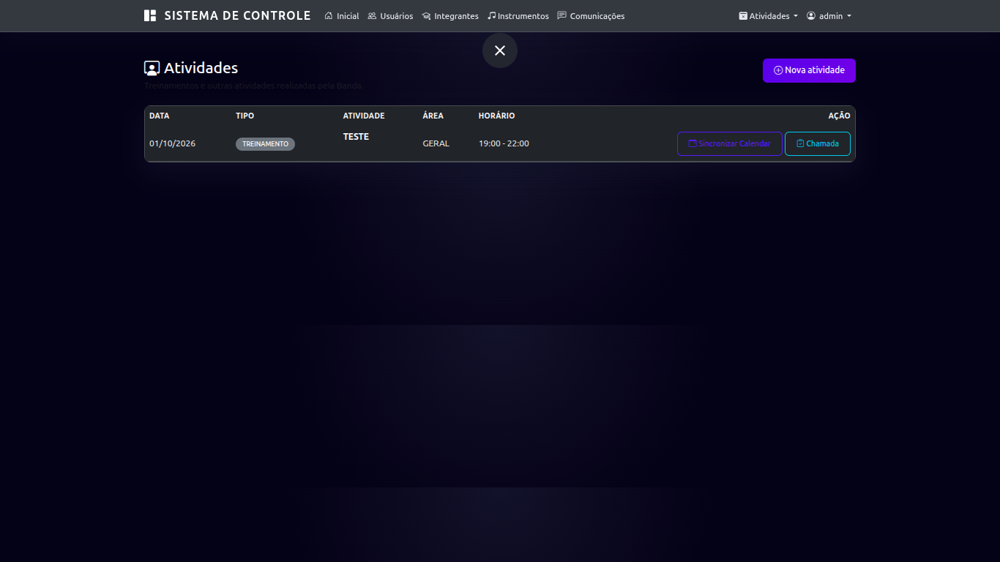

### 9.8 Consultar chamadas e frequência

1. No menu **Atividades**, abra **Ensaios** e clique em **Histórico**.
2. Selecione um integrante ou mantenha **Todos os integrantes**.
3. Clique em **Filtrar histórico**.

O sistema exibirá as chamadas, datas, atividades, locais, integrantes e situações. Quando um integrante for selecionado, será exibido o percentual de frequência calculado com base nos registros disponíveis.

Use **Imprimir** para gerar uma cópia do histórico.

### 9.9 Relatório diário e relatório de evento

O item **Atividades > Relatório de presença** abre a **Folha diária de presença**. Escolha a data e clique em **Consultar data** para ver, em uma única folha, a situação dos integrantes ativos e as atividades registradas. Use **Imprimir** para imprimir ou salvar como PDF.

Na tela **Eventos**, clique em **Relatório** ao lado do evento para abrir a folha consolidada da chamada e usar **Imprimir**.

### 9.10 Consultar o resumo mensal e o relatório profissional

1. Abra o menu **Atividades** e clique em **Resumo mensal**.
2. Informe o mês de referência e clique em **Consultar**.
3. Consulte os totais de presentes, ausentes, justificados e o percentual de frequência.
4. Use **Relatório profissional** para abrir o documento formal do período, com resumo por integrante, resumo por atividade e detalhamento dos registros.

O relatório profissional é preparado para impressão e pode ser salvo como PDF pelo navegador. O relatório considera integrantes ativos e registros do mês selecionado.

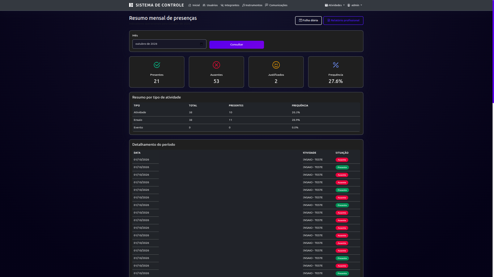

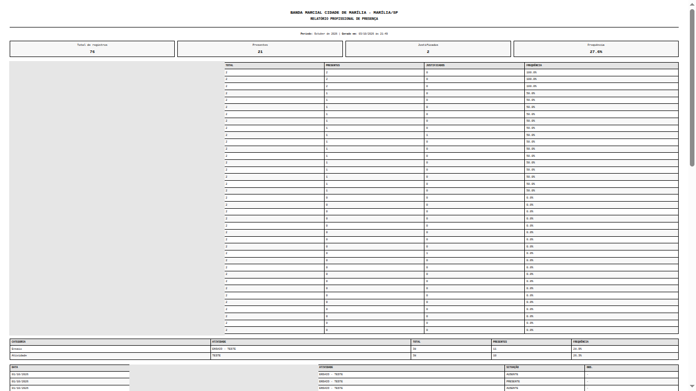

### 9.11 Administrar passes de transporte

O controle de passes está disponível para administradores em **Seu nome > Passes de Transporte**.

1. Selecione o mês de referência.
2. Escolha o tipo de lançamento: **Cota mensal** ou **Avulso**.
3. Selecione um integrante com cartão ativo e informe a quantidade.
4. Para lançamento **Avulso**, informe também o motivo. O avulso pode ser lançado sem cota mensal prévia.
5. Clique em **Confirmar lançamento**.
6. Consulte **Histórico** para verificar disponibilizações, recargas, consumos, estornos e saldos.

Cada presença registrada para integrante com cartão consome 2 passes. Com saldo inferior a 2, a presença é bloqueada. Integrantes sem cartão continuam podendo registrar presença, mas não geram consumo de passes.

A quantidade avulsa deve ser maior que zero, exige motivo obrigatório e pode ser lançada uma única vez por integrante em cada mês. Integrantes sem cartão ativo não podem receber lançamentos de passes. Alterações de presença podem gerar o estorno correspondente no histórico.

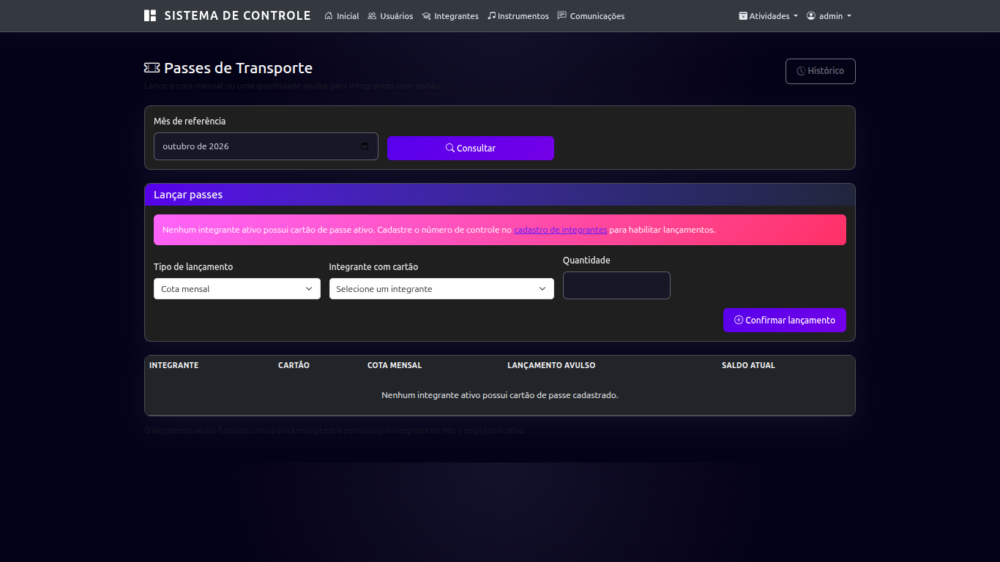

---

## 10. Relatórios

### 10.1 Relatório Geral de Integrantes
Na tela **Gestão > Integrantes**, clique em **Relatórios** para abrir a versão imprimível dos integrantes ativos. O relatório pode conter dados pessoais e vínculos cadastrados; manuseie e imprima essas informações com cuidado.

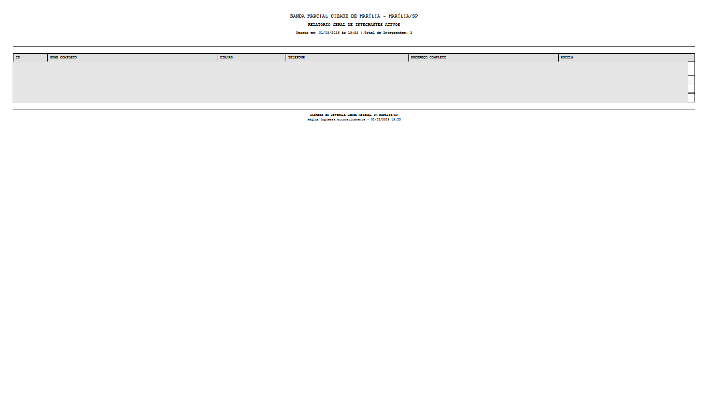

### 10.2 Relatório Individual de Integrante
Na lista **Integrantes**, use o ícone **Relatório** ao lado do cadastro para abrir a versão individual imprimível.

### 10.3 Relatório de Escolas
Na tela **Escolas**, clique em **Relatório** para abrir a lista imprimível de escolas e integrantes vinculados.

### 10.4 Relatórios de presença
O menu **Atividades** oferece:

- **Relatório de presença**: folha diária consolidada, filtrada por data;
- **Resumo mensal**: totais de presentes, ausentes, justificados e frequência, resumo por tipo de atividade e detalhamento do período;
- **Relatório profissional**: no resumo mensal, abre o documento formal do período, com resumo por integrante, por atividade e detalhamento dos registros;
- **Histórico**: na tela **Ensaios**, consulta os registros de chamada, com filtro por integrante e percentual de frequência;
- **Relatório do evento**: na lista **Eventos**, apresenta a chamada consolidada daquele evento.

Use **Imprimir** nas folhas e relatórios que oferecem esse botão e escolha **Salvar como PDF** na janela de impressão do navegador.

---

## 11. Configurações e manutenção (Administrador)

Abra **Seu nome > Configurações**. A página reúne abas para personalizar o sistema, ajustar segurança e executar tarefas de manutenção.

### 11.1 Personalização e serviços Google

Na aba **Personalização**, o administrador pode alterar o logo e os textos da tela de login e do rodapé, configurar o endereço remetente das comunicações e consultar a situação dos serviços Gmail, Google Calendar e Google Drive. Use **Autorizar serviços Google** para iniciar ou renovar as autorizações. O remetente de comunicação deve corresponder à conta Gmail autorizada.

### 11.2 Segurança

Na aba **Segurança**, ajuste o tempo de sessão, o limite de tentativas de login e os requisitos de complexidade de senha. A senha precisa ter pelo menos 6 caracteres; os requisitos selecionados (letra minúscula, maiúscula, número ou símbolo) também serão aplicados.

### 11.3 Sistema e manutenção

Na aba **Sistema/Manutenção**, configure o limite de upload, a pasta dos backups e o período de retenção de logs. A seção de senha dos backups permite, após reautenticação administrativa, revelar a chave atual ou registrar no `.env` uma senha com no mínimo 16 caracteres. Se já existir uma chave ou backup criptografado, use a mesma senha para preservar a capacidade de restauração.

As ações **Limpar Cache**, **Executar Verificação** e **Reindexar** são tarefas administrativas de manutenção. Execute-as com cuidado e peça orientação ao responsável técnico se não souber se são necessárias. **Logs: Hard Delete**, no menu do usuário, permite consultar a auditoria de exclusões permanentes de integrantes.

---

## 12. Backup do Sistema

### 12.1 Criar Backup
1. No menu do usuário, no canto superior direito, selecione **Backup do Banco**.
2. Clique em **Criar Backup Agora**. O sistema sempre cria a cópia local e, quando o Google Drive está autorizado, também tenta enviá-la automaticamente à pasta `BMCM Backups`.
3. Consulte o resultado da operação na mensagem apresentada. Se o Drive não estiver autorizado ou o envio automático falhar, a cópia local será preservada; o botão **Drive** ao lado do arquivo permite tentar o envio manualmente.
4. Consulte as cópias remotas na seção **Backups no Google Drive**. Use **Abrir** para visualizá-las ou **Restaurar** para recuperar uma cópia.

Após o início do sistema, um login válido de administrador agenda um backup em segundo plano quando ainda não existe backup local ou quando o mais recente foi criado há pelo menos 48 horas. Se o Google Drive estiver autorizado, o sistema também tenta enviar essa cópia para a nuvem. O backup automático não interrompe o login.

O envio ao Drive exige que um administrador autorize o escopo Google Drive em **Configurações**. Repetir o envio de um arquivo com o mesmo nome atualiza a cópia remota.

Os novos arquivos ZIP são protegidos com AES-256. Se `BACKUP_PASSWORD` não estiver configurada, o sistema gera uma senha aleatória e a salva em `instance/.backup_password` com permissões restritas. O backup automático anterior à restauração também é criptografado.

**Aviso:** preserve `BACKUP_PASSWORD` ou `instance/.backup_password` em local seguro e separado dos ZIPs. Para restaurar em outro servidor, configure a mesma senha ou transfira o arquivo-chave por um meio seguro. Sem a chave, não será possível restaurar backups criptografados. Não troque a senha enquanto existirem backups AES-256; a interface bloqueia uma troca que os tornaria irrecuperáveis. Backups antigos sem criptografia continuam compatíveis para restauração local, mas backups do Drive precisam estar protegidos com AES-256.

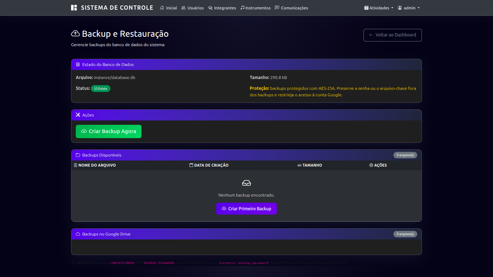

### 12.2 Restaurar Backup
1. No menu do usuário, selecione **Backup do Banco**
2. Na lista local ou em **Backups no Google Drive**, selecione a cópia desejada
3. Clique em **"Restaurar"** e confirme a operação
4. No caso do Drive, o sistema baixa e valida a cópia antes de iniciar a restauração

**Aviso**: A restauração substitui o banco de dados atual. Um backup local de segurança do estado atual é criado automaticamente antes da substituição. Após uma restauração bem-sucedida, reinicie a aplicação para que as alterações tenham efeito. A restauração do Drive exige autorização Google Drive e a mesma chave AES-256 usada para criar o backup.

### 12.3 Excluir Backup
1. No menu do usuário, selecione **Backup do Banco**
2. Selecione o backup desejado
3. Clique em **"Excluir"**

---

## 13. Central de Comunicações

### 13.1 Acesso à Central
A opção **Comunicações** aparece no menu quando o Gmail remetente e a autorização Google necessários estão disponíveis. Contas autenticadas que veem esse item podem abrir a Central para preparar comunicações, consultar o histórico e gerenciar as autorizações de e-mail de contatos externos.

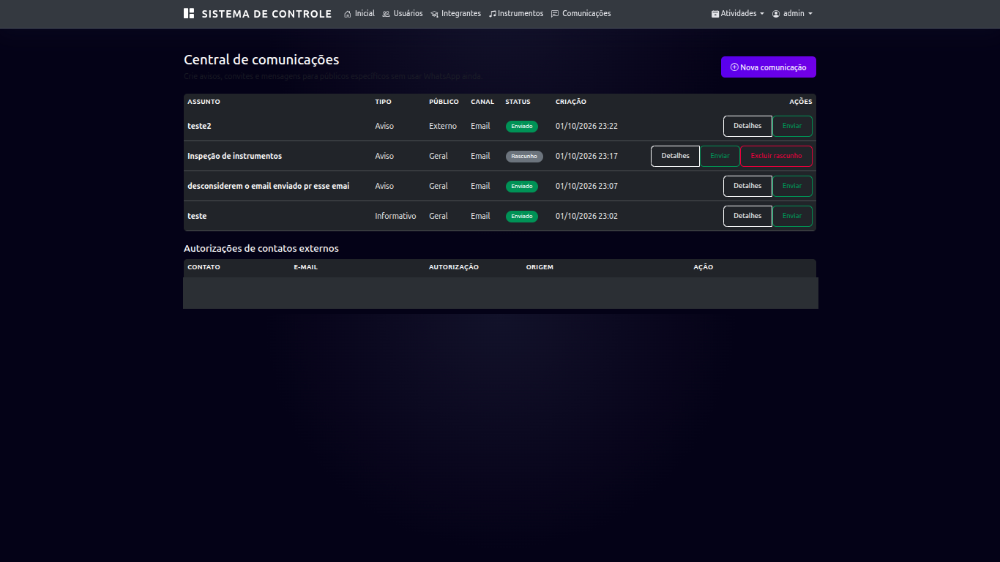

### 13.2 Criar e enviar uma comunicação
1. Acesse **Comunicações** e clique em **Nova comunicação**.
2. Informe assunto, tipo e mensagem.
3. Selecione o público-alvo:
   - integrantes ativos;
   - responsáveis;
   - participantes de um evento;
   - naipe;
   - um contato externo (um destinatário por comunicação).
4. Se necessário, escolha o evento ou naipe e adicione anexos. O canal WhatsApp está desabilitado; o envio disponível é por e-mail.
5. Clique em **Criar comunicação** para salvar como rascunho.
6. Na lista, confira o público e clique em **Enviar**; confirme a operação. Use **Detalhes** para consultar o resultado por destinatário.

Para um contato externo novo ou sem autorização vigente, confirme a autorização de e-mail e informe sua origem. A data e a origem ficam registradas no contato. A autorização pode ser revogada na lista da Central; após a revogação, novos envios são bloqueados. A autorização de e-mail não habilita WhatsApp. Os anexos são armazenados localmente no servidor.

### 13.3 Status do envio
A comunicação pode aparecer com os seguintes status:
- **Rascunho**
- **Enviado**
- **Parcial**
- **Falhou**

O sistema registra o resultado por destinatário e mantém o histórico do envio para auditoria.

### 13.4 Uso do Gmail na comunicação
O envio utiliza a conta Gmail autorizada e o remetente configurado pelo administrador. Se o serviço estiver indisponível, o sistema informa o resultado no histórico; confira os detalhes antes de tentar enviar novamente.

---

## 14. Alteração de Senha

### 14.1 Alterar a própria senha
1. No painel **Inicial**, clique em **Alterar** no cartão **Senha**.
2. Informe a senha atual, a nova senha e a confirmação.
3. Clique em **Atualizar Senha**.

A senha precisa atender ao mínimo de 6 caracteres e às regras de complexidade configuradas pelo administrador.

---

## 15. Sair do Sistema

### 15.1 Sair do Sistema
1. Abra o menu com seu nome no alto da tela.
2. Selecione **"Sair"**, especialmente ao usar um computador compartilhado.

---

## 16. Contas e permissões

O cadastro de usuário distingue contas **administradoras** e contas sem essa marcação. A interface não oferece perfis separados chamados “Profissional” e “Usuário Comum”; as opções e ações variam conforme a conta e as integrações disponíveis.

### 16.1 Administrador
Além das funções comuns disponíveis para uma conta autenticada, o administrador tem acesso a **Usuários**, **Backup do Banco**, **Logs: Hard Delete**, **Configurações** e **Passes de Transporte**. Algumas ações nas telas de integrantes também aparecem somente para administradores.

### 16.2 Conta sem perfil de administrador
Pode acessar as opções de uso disponíveis no menu e nas telas para sua conta, como consultar módulos e registrar atividades ou presenças. Opções administrativas e ações restritas não são exibidas ou não podem ser usadas. Se uma função necessária não estiver disponível, solicite ao administrador o acesso apropriado.

---

## 17. Dicas de Segurança

### 17.1 Boas Práticas de Segurança

- Use uma senha forte com pelo menos 6 caracteres e os requisitos de complexidade definidos pelo administrador.

- Não compartilhe sua senha nem deixe a sessão aberta em computador compartilhado; saia do sistema ao terminar.

- Evite acessar o sistema em redes públicas.

- A conta é bloqueada por 12 horas ao atingir o limite de tentativas configurado pelo administrador. Há também um limite temporário de tentativas por endereço de rede.

- Mantenha o arquivo `.env`, tokens OAuth e a senha/chave de backup protegidos e fora do Git.
---

## 18. Solução de Problemas

### 18.1 Esqueci minha senha
Entre em contato com o administrador do sistema para resetar sua senha.

### 18.2 Usuário bloqueado
O bloqueio da conta dura 12 horas após o limite de tentativas configurado ser atingido. O limite de tentativas por endereço de rede também pode exigir que aguarde um minuto. Se o problema continuar, entre em contato com o administrador.

### 18.3 Não consigo acessar uma funcionalidade
Verifique se seu perfil de usuário tem permissão para acessar aquela funcionalidade. Entre em contato com o administrador se necessário.

### 18.4 Dados não aparecem
Verifique se você tem permissão de acesso. Alguns dados podem estar filtrados por perfil.

### 18.5 Google OAuth não funciona
Verifique se o arquivo `.env` está corretamente preenchido, se as variáveis do Google estão corretas e se a URI de retorno coincide com a configuração registrada no Google Cloud.

---
## 19. Problemas Comuns e Soluções

### ❌ Não consigo salvar o integrante
- Verifique campos obrigatórios
- Se estiver enviando uma foto de pessoa menor de 18 anos, complete o termo e a assinatura do responsável

---

### ❌ CEP não preenche automaticamente
- Verifique conexão com internet
- Preencha manualmente os dados

---

### ❌ Usuário bloqueado
- O sistema bloqueia a conta por 12 horas após atingir o limite configurado
- Se o limite de tentativas por endereço de rede for atingido, aguarde um minuto antes de tentar novamente

---

### ❌ Dados não aparecem
- Verifique filtros ativos
- Confirme permissões do usuário

---

### ❌ Não consigo excluir escola
- Confira se há integrantes vinculados à escola
- Se a remoção continuar indisponível, peça ajuda ao administrador antes de alterar os vínculos

---

## 20. Contato e Suporte

Para dúvidas ou problemas técnicos, entre em contato com o administrador do sistema.

### 20.1 Identificação da versão

A versão atual da aplicação é exibida na tela de login, na área de créditos e nas configurações administrativas.

O formato possui três partes, como em `1.4.5`:

- primeira parte: versão principal;
- segunda parte: atualização ou etapa funcional;
- terceira parte: contagem incremental de alterações. Ao passar de `99`, o segundo componente é incrementado; se ele também passar de `99`, o primeiro componente é incrementado.

Essa identificação é mantida pela equipe responsável pelo desenvolvimento. O usuário não deve alterar a versão pelas configurações do sistema.

---

**Versão do Manual**: 1.3
**Sistema**: Sistema BMCM - Banda Marcial Municipal de Marília
**Data de Criação**: 2026

---
